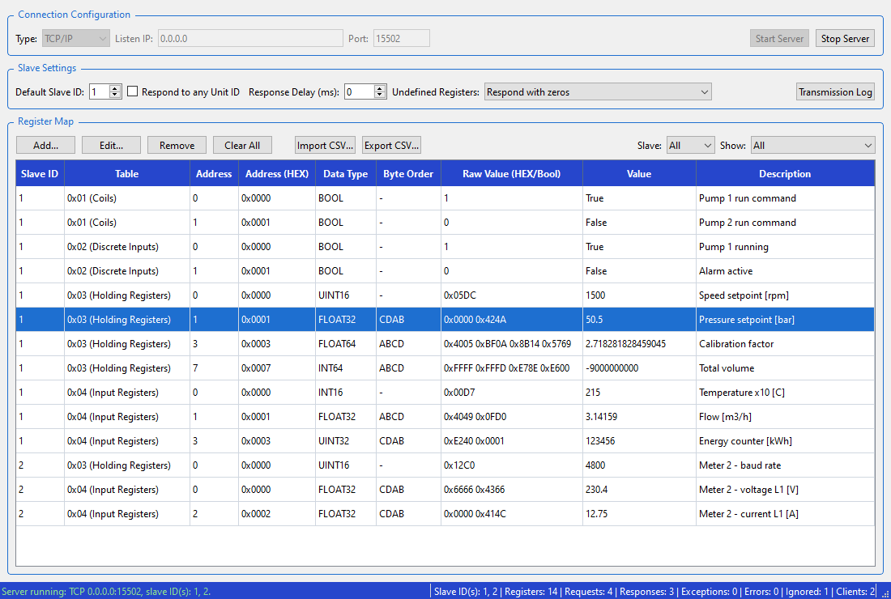
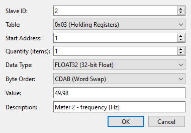
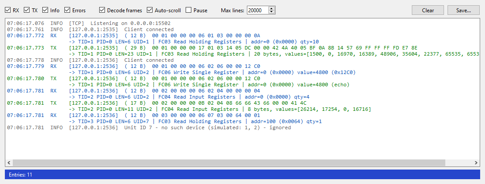

# pymss – Python Modbus Slave Simulator

Symulator urządzeń **Modbus slave** z interfejsem graficznym (PyQt6). Pozwala zasymulować jedno lub wiele urządzeń
na jednej magistrali, podejrzeć każdą ramkę w oknie logów i zapisać mapę rejestrów do pliku CSV.

Narzędzie siostrzane: [pymms](https://github.com/exoper7/pymms) – symulator Modbus **master**. Obie aplikacje
interpretują typy danych i kolejność bajtów w ten sam sposób, więc dobrze się uzupełniają.



## Funkcje

- **Modbus TCP** (serwer, wielu masterów jednocześnie) oraz **Modbus RTU** przez porty COM.
- **Wiele urządzeń na jednej magistrali** – każdy rejestr ma własny Slave ID, każde urządzenie ma osobną pamięć.
- **Okno logów transmisji** – surowe ramki HEX ze znacznikiem czasu (ms), kierunkiem RX/TX i dekodowaniem
  (MBAP, kod funkcji, adres, ilość, wartości, wyjątki).
- **Typy danych** BOOL, (U)INT16, (U)INT32, FLOAT32, (U)INT64, FLOAT64 i **kolejność bajtów** ABCD / CDAB / BADC / DCBA.
- **Import i eksport mapy rejestrów z/do CSV**.
- Konfigurowalna reakcja na zapytania o **niezdefiniowane rejestry**: zera / brak odpowiedzi / wyjątek 02.
- Opóźnienie odpowiedzi, podświetlanie rejestrów zapisanych przez mastera, statystyki na pasku statusu.

## Wymagania i uruchomienie

- Python 3.10+
- Biblioteki: `PyQt6`, `pyserial`

```bash
pip install PyQt6 pyserial
```

```bash
pythonw pymss.pyw
```

Budowa pliku exe (PyInstaller, ikona jest dołączana automatycznie):

```bash
pyinstaller pymss.spec
```

## Instrukcja obsługi

### 1. Połączenie (Connection Configuration)

| Pole | Opis |
|---|---|
| **Type** | `RTU (Serial)` – port COM, `TCP/IP` – serwer Modbus TCP |
| **COM Port, Baud Rate, Parity, Data Bits, Stop Bits** | Parametry portu szeregowego (RTU). Przycisk **↻** odświeża listę portów. |
| **Listen IP, Port** | Adres i port nasłuchu (TCP). `0.0.0.0` – wszystkie interfejsy, `127.0.0.1` – tylko lokalnie. Domyślny port Modbus to 502. |

**Start Server** uruchamia symulator, **Stop Server** go zatrzymuje. Parametrów połączenia nie można zmieniać,
gdy serwer pracuje.

> Przy porcie 502 Zapora systemu Windows może zapytać o zgodę na nasłuch. Do testów lokalnych możesz użyć
> innego portu, np. 1502.

### 2. Ustawienia slave'a (Slave Settings)

Wszystkie ustawienia z tej sekcji można zmieniać w trakcie pracy serwera.

| Pole | Opis |
|---|---|
| **Default Slave ID** | Slave ID nadawany nowym rejestrom i wierszom CSV bez kolumny `slave_id`. To urządzenie odpowiada zawsze, nawet bez zdefiniowanych rejestrów. |
| **Respond to any Unit ID** | Zapytania do Unit ID, dla którego nie ma symulowanego urządzenia, obsługuje urządzenie domyślne. |
| **Response Delay (ms)** | Sztuczne opóźnienie odpowiedzi, przydatne do testowania timeoutów mastera. |
| **Undefined Registers** | Reakcja na zapytanie obejmujące choć jeden niezdefiniowany adres: **Respond with zeros** (odczyt zwraca 0, zapis jest przyjmowany), **Ignore request** (brak odpowiedzi, master dostaje timeout), **Respond with exception 02** (Illegal Data Address). |
| **Transmission Log** | Otwiera okno logów transmisji. |

### 3. Mapa rejestrów (Register Map)

- **Add...** – dodaje jeden lub wiele kolejnych rejestrów tego samego typu. Okno podpowiada pierwszy wolny adres
  dla wybranego urządzenia i tabeli. Dla typów 32- i 64-bitowych kolejne pozycje są rozmieszczane co 2 lub 4 rejestry.
- **Edit...** albo dwuklik na dowolnej kolumnie poza wartością – edycja definicji (Slave ID, tabela, adres, typ,
  kolejność bajtów, opis). Tak można też przenieść rejestr do innego urządzenia.
- Dwuklik na kolumnie **Value** lub **Raw Value** – zmiana samej wartości.
- **Remove** albo klawisz **Delete** – usuwa zaznaczone wiersze. **Clear All** czyści całą mapę.
- Filtry **Slave** i **Show** pokazują rejestry wybranego urządzenia lub wybranej tabeli.
- Rejestry zapisane przez mastera podświetlają się na żółto przez ok. 1,5 s.



Adresy w obrębie jednego urządzenia i tabeli nie mogą się nakładać. Program odrzuci np. UINT16 pod adresem 2,
jeśli pod adresem 1 jest już FLOAT32, który zajmuje rejestry 1–2.

### 4. Symulacja wielu urządzeń

Wystarczy przypisać rejestry do różnych Slave ID, np. w oknie **Add...** albo w kolumnie `slave_id` pliku CSV.
Symulator obsługuje wszystkie Slave ID występujące w mapie rejestrów oraz **Default Slave ID**. Lista
obsługiwanych urządzeń jest widoczna na pasku statusu.

- Zapytanie do nieistniejącego urządzenia jest ignorowane i odnotowane w logu, chyba że zaznaczono
  *Respond to any Unit ID*.
- Broadcast RTU (Unit ID 0) wykonują wszystkie symulowane urządzenia, bez odpowiedzi, zgodnie ze specyfikacją.

### 5. Okno logów transmisji



Każda linia zawiera czas z dokładnością do milisekundy, kierunek (**RX** – zapytanie od mastera, **TX** – odpowiedź),
kanał (port COM albo adres IP:port klienta), długość i pełną ramkę w HEX. Pod ramką jest jej rozkodowanie.

- Filtry **RX / TX / Info / Errors** i opcja **Decode frames**.
- **Pause** wstrzymuje dopisywanie, a **Auto-scroll** przewija log do najnowszego wpisu.
- **Max lines** ogranicza liczbę linii, najstarsze są usuwane.
- **Save...** zapisuje log do pliku tekstowego.
- W trybie RTU w logu pojawiają się też błędy CRC, niepełne ramki i odrzucone bajty.

### 6. Import i eksport CSV

**Export CSV...** zapisuje mapę rejestrów razem z aktualnymi wartościami. **Import CSV...** wczytuje plik i pyta,
czy zastąpić obecną mapę, czy dopisać rejestry do niej. Przykład: [example_registers.csv](example_registers.csv).

```csv
slave_id;table;address;data_type;byte_order;value;description
1;holding_register;0;UINT16;ABCD;1500;Speed setpoint [rpm]
1;holding_register;1;FLOAT32;CDAB;50.5;Pressure setpoint [bar]
1;coil;0;BOOL;ABCD;True;Pump 1 run command
2;input_register;0;FLOAT32;CDAB;230.4;Meter 2 - voltage L1 [V]
```

| Kolumna | Wymagana | Wartości |
|---|---|---|
| `slave_id` | nie | 1–247, domyślnie *Default Slave ID* |
| `table` | **tak** | `coil`, `discrete_input`, `holding_register`, `input_register` (akceptowane też `co`/`di`/`hr`/`ir` i `0x`/`1x`/`4x`/`3x`) |
| `address` | **tak** | 0–65535, dziesiętnie lub szesnastkowo (`0x0010`) |
| `data_type` | nie | `BOOL`, `UINT16`, `INT16`, `UINT32`, `INT32`, `FLOAT32`, `UINT64`, `INT64`, `FLOAT64`. Domyślnie `BOOL` dla bitów i `UINT16` dla rejestrów. |
| `byte_order` | nie | `ABCD`, `CDAB`, `BADC`, `DCBA`, domyślnie `ABCD` |
| `value` | nie | liczba, `0x..` lub `True`/`False`. Akceptowany jest przecinek dziesiętny. |
| `description` | nie | dowolny tekst |

- Separator (`;`, `,` lub tabulator) jest wykrywany automatycznie, a kolumny mogą być w dowolnej kolejności.
- Eksport używa separatora `;`, żeby polska wersja Excela otwierała plik poprawnie.
- Wiersze zaczynające się od `#` są pomijane. Błędne wiersze są pomijane, a program wyświetla ich listę.

## Obsługiwane funkcje Modbus

| Kod | Funkcja |
|---|---|
| 0x01 | Read Coils |
| 0x02 | Read Discrete Inputs |
| 0x03 | Read Holding Registers |
| 0x04 | Read Input Registers |
| 0x05 | Write Single Coil |
| 0x06 | Write Single Register |
| 0x0F | Write Multiple Coils |
| 0x10 | Write Multiple Registers |
| 0x16 | Mask Write Register |
| 0x17 | Read/Write Multiple Registers |

Inne kody funkcji dostają wyjątek 01 (Illegal Function). Błędna ilość lub długość ramki daje wyjątek 03
(Illegal Data Value).

## Kolejność bajtów

Dla wartości 32-bitowej złożonej z bajtów `A B C D` (big-endian):

| Ustawienie | Rejestry | Opis |
|---|---|---|
| ABCD (No Swap) | `AB` `CD` | standard Modbus |
| CDAB (Word Swap) | `CD` `AB` | zamienione słowa |
| BADC (Byte Swap within Words) | `BA` `DC` | zamienione bajty w słowach |
| DCBA (Full Byte Reverse) | `DC` `BA` | pełne odwrócenie |

Dla typów 64-bitowych `CDAB` zamienia połówki 32-bitowe (`W2 W3 W0 W1`), tak samo jak w pymms.
